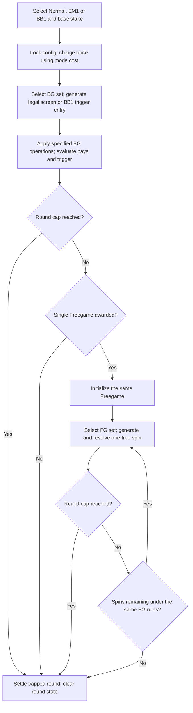

# Game flow — {{game name}}

Status: draft. Fill operation labels and rule references from the GDD. This skeleton depicts one Basegame and one Freegame; amend ordering to match the chosen trigger/cap rules without introducing another feature mode.

## Operation sequence

| Step / rule ID | Random draw | State read / written | Award / cap / transition |
|---|---|---|---|
| {{step}} | {{draw or none}} | {{state}} | {{expected behavior}} |

Show Normal/EM1 probability differences and BB1 forced entry explicitly in the text, retaining the same FG loop. Explain any retrigger ordering and reset.

