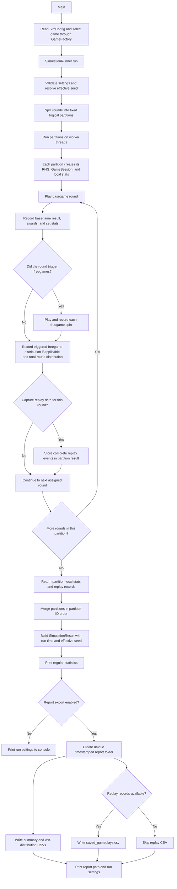

# Architecture

## Overview

### Notion context hub

[JavaSim Context Hub](https://app.notion.com/p/3fea48e4006081d89cf5fe2a776ae367) holds a private, manually exported snapshot of the repository's Markdown context documents, including instructions, architecture, workflows, game specifications, reviews, and lessons learned. Each source page records its repository path and provides the original Markdown download. The repository remains the source of truth; changes are not automatically synchronized. Refresh affected Notion pages after relevant repository documentation changes. Empty `notes.md` is recorded as empty rather than populated with inferred notes.

The project is a small Java Monte Carlo game simulation. `Main` reads the selected game ID from `SimConfig`, asks `GameFactory` to create that game with its own config, and passes it to `SimulationRunner`. It then passes the merged statistics to the reporting class.

The source is grouped into separate game and simulation layers. `Main.java` stays in the default package at the repository root as the launch point; it wires game configuration and an implementation into the simulation layer. The simulation engine depends on the game contract, while game rules stay inside game implementations.

### Notion research hub

The private [JavaSim Research Hub](https://app.notion.com/p/3ffa48e4006081d1ac88d55ba4073624) is the user-designated destination for future research. New dated findings go under [Market Reports](https://app.notion.com/p/3ffa48e400608109b14bec228a729876); separately requested process reviews go under [Skill Evaluations](https://app.notion.com/p/3ffa48e40060817a9a30c6869c805640). The two pilot reports have been moved into those sections with their URLs preserved. The research skill's publication guide records these parent page IDs; an explicit destination in a later request overrides the default. Research is separate from the repository-documentation Context Hub.

The [six-month deep dive](research/2026-10-20-six-month/market-report.md) covers 21 April–20 October 2026, with a claim ledger, source register, method notes and publication record alongside the report. It distinguishes release chronology, sampled performance, operator wagering disclosures, current player-count proxies and qualitative sentiment. Its source/panel gaps and unresolved product-rule conflicts remain research findings rather than approved specifications. The research skill's [source directory](../.agents/skills/javasim-research-slot-market/references/source-directory.md) preserves useful source routes and their measurement/access limitations for future runs. The subsequent [methodology review](research/2026-10-20-six-month/methodology-review.md) records the missed Stake Engine analytics and Waylanders Forge candidate. The corrected report includes a saved public-API snapshot and candidate dispositions; the skill now requires reconciliation with relevant performance leaders and a priority-market coverage review before publication.

## Source layout

- `.agents/skills/javasim-draft-game-spec/`: [fallback game-spec authoring](../.agents/skills/javasim-draft-game-spec/SKILL.md) from the latest relevant market research and corrections. Human-assisted GDD work remains primary. The workflow drafts one Basegame and one Freegame, Normal/EM1/BB1 purchase modes, at most three sets per gameplay state, and at most ten regular plus five special symbol types. It uses only available broad GDD families (currently lines), requires a concrete player benefit for optional features, and supplies GDD, rationale, math/config, Mermaid flow, edge-case and handoff templates alongside the canonical creation form. Unallocated drafts default to `docs/game-specs/<slug>/` until separately reviewed and promoted into a game workspace; authoring does not implement games or establish mathematical approval. EM1 specifies exactly four times Normal's trigger probability per paid round at twice the cost; BB1 enters the same single Freegame with an explicitly proposed or unresolved buy price.

- `docs/research/`: dated market-research artifacts and operational evaluations. The [20 October 2026 pilot](research/2026-10-20/market-report.md) covers 7–20 October releases and separately dated performance evidence, with a claim ledger, [skill-experience report](research/2026-10-20/skill-experience.md), skill-resource hashes, and a publication record tracking the two Notion reports and their research-hub locations. These reports are external evidence and design hypotheses, not approved game rules or configurations.
- `.agents/skills/javasim-research-slot-market/`: web research workflow for online operators including Stake, Roobet, Rainbet and Duel, land-based slots, provider discovery, standout mechanics and screen layouts, comparable performance evidence, and critically assessed player sentiment. Its references define metric/bias checks and verified Notion publication; report and evidence-ledger templates support dated, cited reports. Turnover, GGR, player counters, lobby placement and marketing claims remain distinct evidence types. Research proposes original game ideas without changing game configurations or implementing mechanics automatically.
- `docs/lessons/`: game implementation lessons and follow-up recommendations, including [G001 lessons learned](lessons/G001-LESSONS-LEARNED.md).
- `.agents/skills/`: repository-local workflows for [source review](../.agents/skills/javasim-review-game-spec/SKILL.md), [game implementation](../.agents/skills/javasim-create-game/SKILL.md), [math validation](../.agents/skills/javasim-validate-math/SKILL.md), and [replay diagnosis](../.agents/skills/javasim-debug-replay/SKILL.md). Each includes references to maintained repository sources and task-specific output templates. Math validation also supplies a seeded Java runner template compiled outside the repository, allowing controlled runs without persistent configuration edits. These guide agent work; project instructions, source specifications, and runtime contracts remain authoritative in their existing locations. Invoke a workflow by name, for example `Use $javasim-review-game-spec on game/G001-walkingwild`.
- `game/`: game contracts (`Game`, `GameSession`), selection factory, shared game result types, and implementations.
- `game/broadGDDs/`: cross-game rule references, such as the shared reel, payline, stake-unit, mode, and set conventions in `lines.md`; individual GDDs can specify game-specific exceptions.
- `docs/maths/`: draft cross-game mathematical reference, with [game overview](maths/01_FUNDAMENTALS/GAME_OVERVIEW.md) as its entry point and separate topics for fundamentals, modes, win evaluation, mechanics, interactions, and validation. Most topic files are currently scaffolds. The [fundamentals implementation comparison](maths/reviews/2026-10-22-fundamentals-implementation-review.md) checks the saved rules against Expanding Wild, G001, G002, their actual Config/Reels sheets, and player/simulator handling. It records the reel-wrap wording error, initial-state/randomness and lifecycle ambiguities, and missing coverage. All three current games reset feature state between paid rounds; broader independence claims remain a scope qualification. The review proposes documentation clarifications without changing game behaviour or approving new rules.
- `game/model/`: spin and base-round results passed from game sessions to the simulation layer, including shared round win-cap application and cap-hit metadata.
- `game/proxy/`: current probability-based example game and its `BasicProxyConfig`. Each future game should keep its own configuration with its implementation.
- `game/expandingwild/`: first reel-based game, with separate basegame, freegame, config, config adapter, and detailed spin results. Its game-wide config is separated from basegame and freegame spin sets; each set contains integer-ID regular-symbol strips, insertion rules, and multiplier settings. The adapter translates each set to GMF `Symbol` values.
- `GameModuleFramework/`: reusable symbols, reel strips and grids, weighted symbol insertion, payline evaluation and win selection, paytable award metadata, scatter counting and trigger evaluation, wild expansion, additive multiplier helpers, and generic weighted-table draws.
- `simulation/`: generic Monte Carlo execution and output.
- `simulation/config/`: simulation-wide settings.
- `simulation/books/`: shared weighted replay-book loader, immutable cached typed rounds and input/expectation metadata. The selected `<Mode>-Books` sheet and adjacent `books/saved_gameplays_<mode>.csv` are validated before workers start; repeated IDs add weights and zero weights disable entries. Sampling uses partition RNG only to choose a recorded complete round, then the existing statistics path records it unchanged. [Book workflow](gameplay-books.md).
- `simulation/engine/`: orchestration, worker threads, seeded partitions, and aggregation.
- `simulation/result/`: completed simulation output returned by the engine.
- `simulation/stats/`: incremental statistics and win-distribution calculations.
- `simulation/reporting/`: console formatting and report file creation.
- `toolkit/viewer/`: command-line win finder and screen printer for interactive game inspection. The generic finder runs registered games; the printer shows detailed Expanding Wild, G001 or G002 screens and line awards when those game result types are available.
- `toolkit/reelset/`: exact Cartesian reel-stop enumerator and full-cycle aggregate results.
- `toolkit/replay/`: saved-gameplay lookup, replay calculation, and validation.
- `toolkit/progress/`: shared progress display for long-running simulation and reelset jobs.
- `toolkit/player/`: game launcher, balancing player presentation model, resizable reel viewport, and adapters for Expanding Wild, G001 and G002. Adapters convert structured game outcomes to a shared display model; the window handles stake/cost balance, reel animation, line highlights, feature flow, autoplay, and last-round playback.
- `toolkit/par/`: dependency-free Open XML workbook reader, mode-pair discovery, selected-sheet `.xlsx` exporter, and styled HTML renderer for PAR inputs included in simulation reports. A PAR-backed simulation selects one complete Config/Reels pair for its mode; unprefixed sheets map to Normal. Regular reports include only that selected pair; book-enabled reports also retain the selected Books sheet and mode CSV.
- `toolkit/wizard/`: new-game workspace initializer that creates each `game/GXXX-game-name/` as the single home for source templates, Config/Reels sheets plus an empty Normal-Books table, an agent review log, and package-shaped `src/main/java/` and `src/test/java/` locations without generating game logic.
- `game/G001-walkingwild/`: complete G001 workspace. Specs and the Normal/BB1 PAR workbook are in `source/`; implementation is under `src/main/java/game/walkingwild/`; game-specific tests are under `src/test/java/game/walkingwild/tests/`. `WalkingWildParParser` loads one isolated Config/Reels pair, `WalkingWildConfig` holds validated mode data, Basegame and Freegame components implement the rules, and the session handles scatter-triggered freegames and the max-win cap. The freegame placement routine zeros occupied cells in a temporary heat map while leaving PAR weights intact. G001 is registered in `GameFactory` and the simulation GUI. Its mode cost is carried through generic run metadata and stake exposure; BB1 charges 100 base stakes while configured awards and the cap remain in base-stake units.
- `game/G002-ember-forge/`: [Ember Forge](../game/G002-ember-forge/README.md), the first research-led fallback prototype. Its source package contains the GDD, rationale, flow, edge cases, math design, creation form and reproducible JSON-to-PAR writer. Game-owned code implements a 5×3 ten-line game with six regular/two special symbols, two BG sets, and one eight-spin Freegame whose next-spin Heat increases after wins up to 5×. Normal, EM1 and BB1 use isolated PAR pairs and identical feature rules; EM1 has exactly four times Normal's trigger chance at twice the cost. Typed screens support cap clipping and RNG-free stop replay. A dedicated player adapter and launcher expose the actual game session; the generic engine, statistics and GMF remain unchanged. [Validation](../game/G002-ember-forge/validation/validation-report.md) includes an independent reel oracle plus finite-state Heat analysis, seeded simulations, exported-report replay and desktop checks. This is a rough prototype, with human product and production balance approval pending.
- `ToolkitGUI.java`: root-level Swing launcher with tabs for simulation, win viewing, full reelset evaluation, and replay.
- `Main.java`: root-level application entry point.

## Configuration

### `game.proxy.BasicProxyConfig`

Holds settings used only by the probability-based proxy:

- Win amounts and their cumulative probability thresholds.
- The paytable buckets used by `StandardStats`.
- The number of free spins awarded by a freegame trigger.

### `simulation.config.SimConfig`

Holds simulation-wide values:

- `gameId`: selects which game `Main` asks `game.GameFactory` to construct. It defaults to `expanding-wild`; set it to `basic-proxy` to run the probability proxy. Each factory entry creates that game's own configuration and implementation.
- `rounds`: number of basegame rounds to simulate.
- `stake`: stake per basegame round.
- `seed`: stored seed used when `usePreviousSeed` is enabled; `simulation.engine.SimulationRunner` replaces it with a randomly generated seed otherwise.
- `usePreviousSeed`: selects between replaying the configured seed and generating a new seed for this run.
- `exportReport`: selects console-only detailed output or file-based detailed reporting.
- `showAwards`: controls whether basegame and freegame award counts appear in the regular console and text report.
- `maxSavedGameplays`: maximum replayable rounds retained for CSV export; zero disables capture.
- `threads`: maximum worker threads used to process partitions.
- `partitions`: fixed logical work partitions used for deterministic seeding and result merging.
- `useBooks`: opt-in weighted replay sampling, default false; `bookMetadata` is populated after successful preflight for report provenance and exact finite-book expectations.

For PAR-backed games, `gameMode` selects one complete Config/Reels pair per simulation run and defaults to `Normal`. Every round uses only that pair; configuration values are never combined across modes. Expanding Wild, G001 and G002 parse the selected mode from their PAR workbook. G002 validates consistency across all present pairs while accepting a report workbook containing only the selected pair. Games can provide a `getCostMultiplier()` when a mode's purchase cost differs from the base stake; the runner applies this multiplier to stake exposure and reports it with the run settings.

## Recorded gameplay balance

The [standard human workflow](gameplay-books.md) is GDD → implementation → human PAR balance → simulation/harvest → human replay-weight balance. New games supply complete capture and RNG-free replay reconstruction. In the Simulation window, **Use weighted gameplay books** switches round generation to prevalidated cached recorded rounds. Generic `SimulationRunner` loads book inputs once, chooses an entry per round using relative weights, and preserves the same statistics/capture loop. Game code, GMF rules and statistics classes do not implement book selection. Normal execution remains available without book inputs; book mode never falls back to it on invalid data.

`SavedGameplayCsv.readByIds` bulk-loads selected IDs in one pass, and `ReplayValidation` shares summary/event-win checks between book preflight and the existing report replayer. Book preflight verifies game/mode, all active IDs, replay consistency, results and no fresh RNG. Reconstructed results are cached at the requested stake, while purchase cost controls exposure. Reports retain selected Config/Reels/Books plus the mode source CSV under `books/`. Console and text summaries keep the Book CSV path but omit logical partitions, the book toggle/sheet/counts/weights, finite-book expectations and source hashes; that metadata remains available internally for validation and provenance checks. HTML includes book weights. Changes to the source inputs during a run prevent book-report export. Current G002 examples and test results are in its [book validation](../game/G002-ember-forge/validation/books-2026-10-21/validation-report.md).

## Simulation flow

A browser page with visual renderings of the documented Mermaid diagrams is available at [flowcharts.html](flowcharts.html). It includes simulation, game creation, math validation, replay debugging, and the architecture overview. The page loads Mermaid from a CDN, so browser access requires an internet connection.

The standalone diagram, including both CLI and GUI entry points and the reporting export branches, is in [simulation-flow.md](simulation-flow.md).

For the recommended steps to add a future game module, see [game-creation-flow.md](game-creation-flow.md). The flow now includes an optional playable prototype after game registration: a game adapter maps round results into shared display data, and the shared player window presents basegame and feature outcomes without taking on game math or simulation responsibilities. Validate the display against representative wins, losses, and triggered feature rounds.

Use the fillable [game creation form](game-creation-form.md) to capture a new game's rules, configuration, implementation plan, tests, and validation evidence end to end.

For a visual rendering of the current Expanding Wild defaults as two-dimensional tables, open [Expanding Wild config tables](expanding-wild-config-tables.html).

For a concise game, balancing workflow, and handover overview, open [Expanding Wild game information](expanding-wild-game-info.html). It summarizes current defaults and recommends Excel authoring with a validated, versioned JSON handoff.

For the Expanding Wild rules, configuration, features, results, replay, and known math limitations, see [ExpandingWildGame.md](../game/expandingwild/ExpandingWildGame.md). It is the detailed game-specific reference and complements this framework overview.

For validating game balance inputs and interpreting simulator output, see [game-math-validation-flow.md](game-math-validation-flow.md). For reconstructing and diagnosing saved rounds, see [replay-debugging-flow.md](replay-debugging-flow.md).



`simulation.engine.SimulationRunner` resolves the run's effective seed from `SimConfig.usePreviousSeed`. It divides the configured rounds into a fixed number of logical partitions and derives one seed from the run seed and each partition ID. Each task owns its `Random`, `GameSession`, statistics collectors, and at most the configured replay records for its round range. The game implementation creates sessions from the supplied random stream, keeping random sequences deterministic per partition. Tasks do not update shared statistics.

After all tasks finish, the runner merges each partition's statistics in partition-ID order. Fixed partitions and ordered merging keep results reproducible when the same seed, settings, and partition count are used, even if the worker-thread count changes. The effective seed and logical partition count are printed at the end of the console output and `simulation_stats.txt`.

`Main` creates `SimConfig`, asks `GameFactory` for the selected game, invokes the runner, and passes the merged results to `Print`. The factory creates the selected implementation together with its game-specific config. Each partition runs its assigned basegame rounds through `GameSession.playRound(totalRoundStake, maximumRoundWin)`. A game's `getMaxWinMultiplier()` supplies its round cap in base stake units; the default is unlimited. The shared result layer clips outcomes that exceed the cap and drops later feature spins. Cap clipping uses bounded arithmetic adjustments so floating-point rounding cannot cause an unbounded retry loop. Games can override the capped session method to stop generating feature outcomes as soon as the cap is reached. `GameRoundResult` records whether the cap was reached. The engine then:

1. Records the base spin in basegame statistics.
2. If the base result triggers free spins, records the trigger and each returned free spin in freegame totals, paytable buckets, and any named award categories returned with the spin.
3. Records one freegame distribution result equal to the sum of the free spins returned for that trigger.
4. Records one total-game result and distribution equal to the basegame win plus any freegame wins for the round, and increments TotalGame Wincaps when the round reaches the configured cap.

This means the three win distributions have different observation units: basegame entries are base rounds, freegame entries are triggered freegames, and total-game entries are base rounds. A round without a freegame has no freegame distribution entry. Freegame RTP uses one basegame stake exposure per base round, not one stake per free spin.

### `simulation.engine.SimulationRunner` and `simulation.result.SimulationResult`

`SimulationRunner` validates the worker settings, resolves the seed, submits fixed partitions to an executor, and merges partition-local statistics in partition order. For games that expose set counts, it also aggregates a separate stats collector for each basegame and freegame set. It retains up to `maxSavedGameplays` rounds that return a complete ordered replay event list. `SimulationResult` carries these collectors and replay records back to `Main` for reporting.

### Replay records

`game.model.ReplayEvent` is a game-neutral envelope containing an event type, recorded win, and opaque game-owned payload. `GameRoundResult` returns the ordered replay events for the round, and `GameSession.replayRound` is the injection point used to recalculate them. A game may define any event types and payload schema; the simulation and CSV writer do not interpret that payload. `SavedGameplayCsv` writes one row per event with a repeated gameplay ID and round summary, allowing rounds with any number of feature events. A game that does not supply replay events is omitted from saved-gameplay output.

Expanding Wild stores the selected set, reel stops, inserted symbol locations, and resolved banner multiplier choices in a versioned JSON payload. Replaying injects these recorded choices directly, then recalculates the line wins using the active paytable and win cap. G001 stores the selected set, six reel stops, scatter insertion positions, and Freegame new/moved wild destinations for each event. Replay reconstructs each 6×4 screen from those choices and recalculates its line awards without drawing fresh outcomes. G002 records its selected set and five stops in each versioned event, reconstructing Heat from preceding wins. The recorded total, basegame, feature, and per-event wins are checked against recalculated outcomes by `toolkit.replay.ReplayerMain`. Reports containing replayable rounds add `saved_gameplays.csv`; distribution CSV formats remain unchanged.

Run the replayer from the project root with `java toolkit.replay.ReplayerMain reports/<report-folder>/saved_gameplays.csv <gameplay-id>`.

### `game.GameFactory`

Maps the `SimConfig.gameId` selection to a game implementation and constructs it with its game-specific configuration. `Main` passes the resulting `Game` to the runner and does not import a game's config class. Register future game implementations here with their own configuration classes.

## Game and result classes

### `game.Game` and `game.GameSession`

`Game` provides the paytable bucket shape, optional named award labels, a maximum win multiplier (unlimited by default), a mode cost multiplier (1 by default), and creates sessions for a supplied random stream. Each `SpinResult` can carry zero or more award labels; statistics aggregate every occurrence, including multiple same-category line awards in one spin. Sessions receive the total round stake and absolute cap so game-specific paytables can scale line awards and stop features at the cap. `GameRoundResult` reports whether the cap was reached. The engine knows the shared round/result contract but does not construct specific game classes.

### `game.proxy.BasicProxyGame`

Implements `Game` using the simple probability-based proxy rules. Its session owns the proxy's basegame and freegame logic and returns their outcomes through the game contract.

### `game.proxy.GameBasic`, `GameBasicBase`, and `GameBasicFree`

These classes implement the proxy's individual spin logic. They are an example game implementation, not dependencies of the simulation engine.

### `game.expandingwild.ExpandingWildGame`

Implements the existing game contract with a 5x5 reel game. It keeps basegame and freegame logic separate, uses GMF for weighted symbol insertion and reel/grid and payline math, expands visible banners into full-height wild reels, and draws configured banner multipliers before adding participating multipliers on paylines. Its configuration caps each basegame round at the configured stake multiple; the session clips the spin that reaches the cap and stops further free spins. The full reelset tool deliberately evaluates only regular reel symbols and paytable wins, skipping all feature mechanics. See [ExpandingWildGame.md](../game/expandingwild/ExpandingWildGame.md) for the current PAR results and known limits.

`ExpandingWildParParser` maps the selected mode's Config and Reels sheets into `ExpandingWildConfig`. It reads game-wide settings, the symbol paytable, paylines, the scatter award map, selectors, per-mode/per-set insertion counts and heat maps, banner multipliers, and reel strips. `GameFactory.create(gameId, parPath, mode)` validates the selected pair and game-specific PAR before creating a game. The Simulation tab offers the workbook's available modes; reports retain an `.xlsx` copy containing only the selected pair and an HTML rendering of those sheets. Freegame scatter retriggers are not implemented: the parser rejects PARs that give positive weight to nonzero freegame scatter counts.

### G001 Walking Wild (`game.walkingwild.WalkingWildGame`)

Implements G001's 6×4, 20-line game using the selected mode from `source/G001-walkingWildsPAR.xlsx` in the same `game/G001-walkingwild/` workspace. The Basegame selects BG-0/BG-1, draws six reel stops, inserts weighted scatters into eligible cells, evaluates one highest paytable result per line, and maps scatter counts to awarded freegames. The Freegame selects its configured reel set and new-wild count from the table conditioned on existing wild count, draws new wilds with the reels, and relocates persisted wilds after the stop. A temporary copy of the location weights excludes all occupied destinations; at most five wilds remain active. The session clips at the configured 100× base-stake cap and stops further freegames. BB1 has a cost multiplier of 100, but its win amounts stay in base-stake units. `WalkingWildParParser` validates and loads only the selected mode's Config/Reels sheets. G001 supports exhaustive reel-stop evaluation of its Basegame reel strips and payline wins; that tool intentionally omits the random scatter insertion and triggered Freegame. Deterministic rule/parser/report checks are in `game/G001-walkingwild/src/test/java/game/walkingwild/tests/WalkingWildGameTests.java`; see [G001 lessons learned](lessons/G001-LESSONS-LEARNED.md) for implementation notes and G002 improvements.

### `GameModuleFramework`

Provides small reusable components used by the reel game: `Symbol`, `ReelStrip`, `ReelGrid`, `WildExpansion`, `Payline`, `Paytable`, `PaytableAward`, `PaylineEvaluator`, and `PaylineWinCalculator`. The generic calculator stake-scales line candidates, accepts a candidate-specific multiplier function, and resolves candidate wins using a `LineWinSelectionPolicy` (Expanding Wild selects the highest final payout). GMF also provides `ScatterCounter`, `ScatterTrigger`, `AdditiveMultipliers`, and `probability.WeightedTable`. The game config owns its symbols, symbol-ID mapping, integer reel strips, paylines, paytable, and feature settings; a game adapter converts integer strips into GMF reels. Multiplier assignment and result adaptation remain in the game module.

### `toolkit.viewer`

`ViewerMain` accepts a registered game ID and optional spin limit and stake. `WinFinder` creates a random game session and searches basegame and triggered freegame results until it finds the first positive-win screen or reaches the limit. `WinScreenPrinter` renders Expanding Wild's expanded grid and line details G001's 6×4 grid and line awards, and G002's 5×3 grid, Heat and line awards; games that provide only shared `SpinResult` data display their win and named awards. The GUI viewer also selects a PAR workbook/mode and can open a found G001, G002 or Expanding Wild round in the corresponding player adapter. Run the CLI from the project root with `java toolkit.viewer.ViewerMain G001-walkingwild`.

`FullReelsetMain` runs every unique stop-index combination for a game implementing `ExhaustiveReelGame`. `FullReelsetSimulator` partitions the Cartesian index range across selectable basegame sets, applies selector weights to award hits, RTP, and feature triggers, and does not execute triggered features. Weighted evaluation requires selectable sets to have the same total number of stop combinations. `ReelsetReportPrinter` presents award hits as a matrix with symbols in rows and match lengths in columns. `ReelStrip.windowAt` and `ReelGrid.atStops` provide the deterministic GMF stop-to-screen path. Both exhaustive and Monte Carlo runners use `toolkit.progress.ProgressBar` for large workloads; progress is written to standard error and small runs stay quiet. Run the exhaustive tool with `java toolkit.reelset.FullReelsetMain expanding-wild 1.0 8`.

### `game.model.SpinResult` and `game.model.GameRoundResult`

Immutable results for an individual spin and a complete basegame round. A round result contains one basegame spin and the list of freegame spins it triggered.

### `ToolkitGUI`

Launch the desktop toolkit from the repository root with `./run.sh`. This compiles every Java source into `build/classes` and runs `ToolkitGUI` on that shared classpath, including G001 and G002 sources nested inside their workspaces. Pass a different main class when needed, for example `./run.sh Main`. Its Simulation tab exposes game ID, PAR workbook and available mode, rounds, stake, seed reuse, report export, award display, worker threads, logical partitions, saved-gameplay count and the weighted-gameplay-books toggle. The Win viewer takes game ID, PAR workbook/mode for PAR-backed games, maximum spins, and base stake; Full reelset takes game ID, stake, and workers; Replay takes a saved-gameplay CSV and gameplay ID. The Game launcher opens the Expanding Wild, G001 or G002 player after selecting its PAR and mode. All have a resizable animated player, line highlights, autoplay, balance accounting for mode cost, and last-round playback. The New game tab creates a complete `GXXX-game-name/` workspace under the selected game folder root, with source materials, PAR, package-shaped Java and test locations, and README instructions. The GUI runs each operation on a background worker and streams its output into the window. Simulation reporting accepts a supplied writer so console output and report files stay consistent.

The Prototype player tab opens a separate resizable play window. It can also be launched directly with `java toolkit.player.PlayerMain`. `PlayerGameAdapter` maps a normal game-session round into `PlayerDisplayData` (stopped and transformed grids, awards, highlight positions, feature spins, and display metadata); the player renders that data without using simulation statistics or report generation. Adapters cover Expanding Wild, G001 and G002. Launch G002 directly with `./run.sh toolkit.player.EmberForgePlayerMain Normal` (or EM1/BB1); its compact placeholder symbols and current/next Heat come from the G002 adapter. Positional wins support line, ways, or cluster highlighting, and the viewport sizes itself from the grid dimensions. The player maintains a local balance, supports manual or counted autoplay, and animates reels before revealing post-stop wild expansion and wins. Autoplay stop takes effect after the current complete round, including its triggered freegames. The viewer can preload its found Expanding Wild round as a no-cost preview; Replay Last Play charges the original stake and repeats that saved display outcome, including its feature spins.

## Statistics

### `simulation.stats.StandardStats`

Accumulates spin counts, total winnings, generic paytable buckets, named award counts, freegame trigger counts, stake exposure, and a win distribution. It receives the stake, paytable shape, and award labels when constructed rather than creating game configuration objects itself.

`addResult` records one individual spin in regular totals, paytable buckets, and named award counts. `recordWinInDistribution` separately records the value that represents one observation in a distribution. This separation lets freegame totals count each free spin while its distribution counts one sum per triggered freegame. Freegame RTP divides its winnings by basegame stake exposure recorded by the runner.

The win distributions map each win amount to a `long` frequency. Standard deviation is computed from the distribution. Aggregated win-band rows use inclusive minimums and exclusive maximums: `[0, 1)`, `[1, 2)`, `[2, 3)`, `[3, 5)`, and successive bands through `[25,000, ∞)`. An exact threshold is assigned to the band that begins at that threshold, and all outcomes are covered.

Each aggregate band reports:

- **Hits:** observations in that band.
- **Hit Rate:** band hits divided by observations in that distribution.
- **HR Freq:** observations divided by band hits; zero when the band has no hits.
- **RTP:** band total win divided by total simulation stake.

Hit Rate and HR Freq use each distribution's own observation count. RTP uses total basegame stake for all three distributions so the rows show each category's contribution to overall simulation RTP. In `win_distribution_aggregated.csv`, the order is Distribution, Range Min (>=), Range Max (<), Hits, Hit Rate, HR Freq, RTP.

## Reporting

### `simulation.reporting.Print`

Formats the regular summary and detailed distributions using the same generic layout for every game. The total section reports RTP split by basegame and freegame, a basegame hit frequency, freegame frequency and average session win, configured max win and cap frequency, and total/base/free standard deviations. Mode sections report rounds, winnings, RTP, hits, and standard deviation; configured reel sets follow each mode. Basegame deviation uses individual basegame wins, while freegame deviation uses one whole freegame session per trigger. `SimulationResult` carries the selected game's max-win multiplier so the shared report can display that setting without game-specific logic. Named award counts appear when enabled and available. Reported win amounts are rounded to one decimal place in stake units to suppress floating-point display tails while preserving enough decimal places for the configured stake; distribution rows that round to the same displayed value are combined, including their hit counts. This changes presentation only; stored simulation values remain unchanged.

When `exportReport` is `false`, the console receives only the regular summary statistics and run settings, including the selected game ID. No report files are created.

When `exportReport` is `true`, the console receives the regular summary statistics, a path to the generated report folder, and the run settings at the bottom, including the selected game ID. Detailed files are written under `reports/` in a timestamped `simulation-YYYY-MM-DD_HH-mm-ss` folder. A numeric suffix is added if another report already uses that timestamp. Each folder contains:

- `simulation_stats.txt`: the regular summary printed to the console, followed by selected game ID/mode, input paths, effective seed and total simulation time.
- `win_distributions.csv`: raw win amounts and hit counts.
- `win_distribution_aggregated.csv`: aggregated win-band values.
- `saved_gameplays.csv`: versioned event rows for replayable rounds, when the selected game supplies replay events.

Both CSVs group their sections in this order, with a blank row between sections: **Total Game, Basegame, Freegame**. The generated `reports/` directory and compiled `.class` files are ignored by Git.

## Tests

Validation is selected by the current task's behavioural impact, as defined in [AGENTS.md](../AGENTS.md). Documentation, research, instructions, and non-executable skill/template edits use content, link, and format checks without Java compilation, game tests, or simulation runs. Game/math/engine changes require compilation, affected tests, and a small seeded run of the affected game/mode; other executable changes use focused checks. Explicit requests to validate or debug can require runtime checks without implementation changes. Existing unrelated working-tree changes do not expand the validation scope. The commands below are available suites, not a checklist to run for every task.

`tests/SimulationTests.java` covers generic statistics, deterministic merging, game selection, and reports. `GameProjectWizardTests` verifies starter files, sequential codes, collision handling, and the generated Config/Reels/Normal-Books workbook. `BookSimulationTests` covers weighted selection, replay-only execution, missing/invalid inputs, full statistics, stake/cost scaling, worker reproducibility, real G002 modes and portable report bundles. `game/expandingwild/tests/ExpandingWildGameTests.java` covers GMF mechanics, game rules, and a seeded simulator run. G001 deterministic rule/parser/report checks are in `game/G001-walkingwild/src/test/java/game/walkingwild/tests/WalkingWildGameTests.java`. `ExpandingWildParParserTests` checks PAR mapping, a seeded PAR-backed simulation, report assets, and replay against the report workbook; `ExcelWorkbookReaderTests` checks generic workbook parsing and HTML rendering. `ViewerTests`, `ReelsetTests`, and `ReplayTests` cover the toolkit flows; `PlayerTests` checks the player adapter, found-round adaptation, variable-size display model, and separation of stopped reels from expanded wilds. G002 adds `EmberForgeGameTests` (rules, parser, caps, replay, adapters and repeatability), `EmberForgeMathAudit` (independent small-reel enumeration and exact Heat moments), and optional `EmberForgePrototypeCheck` (actual desktop windows, costs and settlement). Its [validation folder](../game/G002-ember-forge/validation/validation-report.md) retains reports, source/code hashes and reproduction helpers. Run the suites with:

```sh
./build.sh
java -cp build/classes SimulationTests
java -cp build/classes BookSimulationTests
java -cp build/classes game.expandingwild.tests.ExpandingWildGameTests
java -cp build/classes game.expandingwild.tests.ExpandingWildParParserTests
java -cp build/classes toolkit.par.ExcelWorkbookReaderTests
java -cp build/classes GameProjectWizardTests
java -cp build/classes PlayerTests
java -cp build/classes ViewerTests
java -cp build/classes ReelsetTests
java -cp build/classes ReplayTests
java -cp build/classes game.walkingwild.tests.WalkingWildGameTests
java -cp build/classes game.ember_forge.tests.EmberForgeGameTests
java -cp build/classes game.ember_forge.tests.EmberForgeMathAudit
```

From the repository root, the normal launch flow is:

```sh
./run.sh Main
```

Launch the GUI with `./run.sh` or `./run.sh ToolkitGUI`. To compile without launching, run `./build.sh`; its `build/classes` output is the runtime classpath for all game packages.

## Current scope

The code is an example simulation framework rather than a general-purpose engine. `simulation.engine.SimulationRunner` handles orchestration and parallel execution through the `game.Game` / `game.GameSession` contract. `game.proxy`, `game.expandingwild`, G001 and G002 implement that contract. The initial `GameModuleFramework` package contains reusable reel and line-win math; new generic mechanics should be added only when another game can use them.

Current boundaries to keep in mind: `GameRoundResult` and simulation accounting model one basegame result plus freegame spins, replay injection and the prototype player support Expanding Wild, G001 and G002, and generic exhaustive reelset evaluation covers supported basegame outcomes only. G002 has a separate bounded exact audit for its reel products and Heat law. Game-specific parsers load external PAR workbooks into Java configuration objects; this is not yet a universal cross-game declarative schema. The GUI also has no cancellation control yet.
