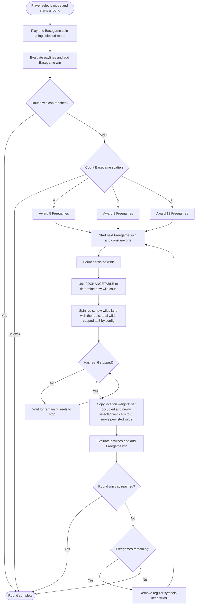

# walkingWild Game Flowchart

This Markdown diagram combines the full round flow from the GDD and shared line-game rules with the freegame spin sequence shown in [`flowchart.pdf`](flowchart.pdf). The PDF covers the freegame subflow only.

Notes:

- The selected mode is chosen before the round and supplies the Config/Reels pair for its spins.
- The PAR scatter map awards 5, 8, or 12 Freegames for 4, 5, or 6 scatters. Counts below 4 do not trigger the feature.
- The PDF says persisted wilds remain in limbo above the reels while the reels spin, then move after reel 6 stops. Newly selected wilds land with the reels.
- Persisted wilds use a temporary copy of the same Freegame location weights. Set cells occupied by newly landed wilds and persisted wilds already placed to 0 for this placement sequence; preserve the original PAR weights. The config limits the total to 5 active wilds, preventing more wilds from being requested than the screen can support.
- The PDF does not define Freegame retriggers; the GDD says there are no scatters in the Freegame, so this flow has no retrigger branch.
- The common max-win rule clips the spin that reaches the cap and ends any remaining Freegames.
