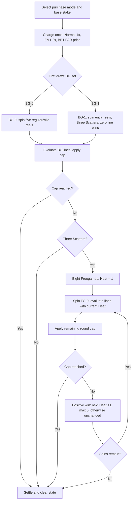

# Ember Forge round flow

Rules: [GDD.md](GDD.md). Normal and EM1 differ only in selection weights and cost; BB1 selects the same entry set with probability one.

All spins use the supplied session RNG. A mode is not redrawn inside a round. Replay recalculates every screen and Heat change from its recorded inputs.
